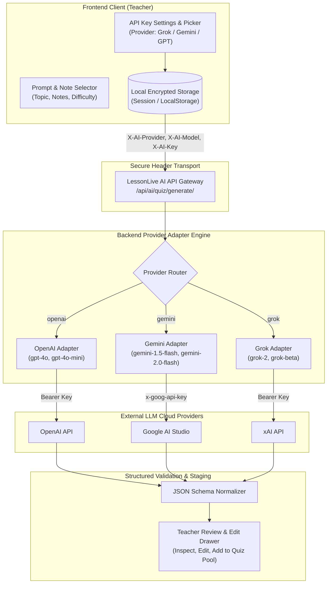

# Implementation & Test Plan: AI Quiz Generator, Lecture Summaries & BYOK

**Target Directories:**
- Backend: `backend/classroom/ai/` (providers, views, serializers, tests)
- Frontend: `frontend/src/src-output/components/ai/` & `frontend/src/src-output/components/LiveQuizCard.jsx`  
**Document Status:** Persistent Architecture & Implementation Specification  
**Associated Features:**
1. AI Quiz & Question Generator
2. AI Lecture Summary & Study Guide Generator
3. BYOK (Bring Your Own Key) Multi-Model Architecture (Grok, Gemini, GPT)

---

## 1. Executive Summary & Value Proposition

### Current Pain Points
- **Time-Consuming Quiz Authoring**: In `LiveQuizCard.jsx`, teachers must manually type every question, 4 options, and correct answers from scratch during or prior to class.
- **Manual Study Material Generation**: After a live lecture concludes, students only have raw notes without structured synthesis, key vocabulary definitions, or review guides.
- **Platform AI Cost Constraint**: Educational platforms offering native AI face severe API token costs at scale.

### Target Solution
- **One-Click AI Quiz Generation**: Teachers select lecture notes or enter a topic prompt; AI automatically drafts structured multiple-choice questions with answer keys ready for review.
- **Automated Lecture Summaries**: At session end, AI synthesizes all displayed lesson notes into an educational study guide (Core Concepts, Vocabulary Table, Self-Assessment) and persists it directly into the classroom resources.
- **BYOK (Bring Your Own Key)**: Zero API cost for the platform. Teachers provide their own API key and choose their preferred provider:
  - **OpenAI (GPT-4o, GPT-4o-mini)**
  - **Google (Gemini 1.5 Flash, Gemini 1.5 Pro, Gemini 2.0 Flash)**
  - **xAI (Grok-2, Grok-beta)**

---

## 2. BYOK Multi-Model Architecture & Security Model



### 2.1 Provider & Model Matrix

| Provider | Supported Models | Default Model | Strengths / Best For |
| :--- | :--- | :--- | :--- |
| **Google Gemini** | `gemini-1.5-flash`, `gemini-1.5-pro`, `gemini-2.0-flash` | `gemini-1.5-flash` | Free tier availability, ultra-fast generation, large context window |
| **OpenAI (GPT)** | `gpt-4o`, `gpt-4o-mini` | `gpt-4o-mini` | Cost-effective, strict JSON Schema mode, widespread key ownership |
| **xAI (Grok)** | `grok-2`, `grok-beta` | `grok-2` | Deep reasoning, natural language nuances, alternative to Big Tech |

### 2.2 Security & Key Isolation Principles
1. **Zero Database Logging**: User API keys are **never saved to server database tables** or written to server logs by default.
2. **Ephemeral Header Transport**: Keys are transmitted over HTTPS via request headers (`X-AI-Key`, `X-AI-Provider`, `X-AI-Model`).
3. **Client-Side Safe Storage**: Keys are stored locally in the teacher's browser `localStorage` under an obfuscated key and cleared upon logout.
4. **Key Validation Endpoint**: A lightweight test endpoint (`POST /api/ai/validate-key/`) verifies API key validity before running resource-intensive generation prompts.

---

## 3. Backend Provider Implementation (`backend/classroom/ai/`)

### 3.1 Unified Provider Interface (`base_provider.py`)
```python
from abc import ABC, abstractmethod
from typing import Dict, Any, List

class BaseAIProvider(ABC):
    @abstractmethod
    def generate_quiz(self, prompt: str, notes_context: str, count: int, difficulty: str, model: str) -> List[Dict[str, Any]]:
        """Generates structured questions matching LessonLive schema."""
        pass

    @abstractmethod
    def generate_study_guide(self, classroom_name: str, notes_context: str, model: str) -> str:
        """Generates markdown study guide with takeaways, vocabulary, and questions."""
        pass

    @abstractmethod
    def validate_key(self, model: str) -> bool:
        """Verifies key validity with minimal token test."""
        pass
```

### 3.2 Provider Implementations (`providers.py`)

#### 1. OpenAI Adapter (`OpenAIProvider`)
Uses official `openai` SDK or direct HTTP with JSON Object mode:
```python
import json
import requests

class OpenAIProvider(BaseAIProvider):
    def __init__(self, api_key: str):
        self.api_key = api_key
        self.base_url = "https://api.openai.com/v1"

    def generate_quiz(self, prompt: str, notes_context: str, count: int, difficulty: str, model: str):
        system_prompt = (
            f"You are an expert educator. Generate {count} multiple-choice questions at {difficulty} difficulty.\n"
            "Output MUST be valid JSON with this exact schema:\n"
            "{\n"
            '  "questions": [\n'
            '    {\n'
            '      "text": "Question prompt",\n'
            '      "options": ["Option A", "Option B", "Option C", "Option D"],\n'
            '      "correct": 0,\n'
            '      "contextNote": "Brief hint or explanation"\n'
            '    }\n'
            '  ]\n'
            "}"
        )
        user_content = f"Topic/Prompt: {prompt}\n\nLesson Notes Context:\n{notes_context}"

        response = requests.post(
            f"{self.base_url}/chat/completions",
            headers={"Authorization": f"Bearer {self.api_key}", "Content-Type": "application/json"},
            json={
                "model": model or "gpt-4o-mini",
                "messages": [
                    {"role": "system", "content": system_prompt},
                    {"role": "user", "content": user_content}
                ],
                "response_format": {"type": "json_object"},
                "temperature": 0.7,
            },
            timeout=30
        )
        response.raise_for_status()
        data = response.json()
        result = json.loads(data["choices"][0]["message"]["content"])
        return result.get("questions", [])
```

#### 2. Google Gemini Adapter (`GeminiProvider`)
Uses Google AI Studio REST API with structured response mime-type:
```python
class GeminiProvider(BaseAIProvider):
    def __init__(self, api_key: str):
        self.api_key = api_key
        self.base_url = "https://generativelanguage.googleapis.com/v1beta/models"

    def generate_quiz(self, prompt: str, notes_context: str, count: int, difficulty: str, model: str):
        target_model = model or "gemini-1.5-flash"
        url = f"{self.base_url}/{target_model}:generateContent?key={self.api_key}"
        
        system_instruction = (
            f"Generate {count} multiple choice questions in JSON at {difficulty} difficulty. "
            "Schema: { 'questions': [ { 'text': string, 'options': [string x 4], 'correct': int (0-3), 'contextNote': string } ] }"
        )
        
        payload = {
            "contents": [{"parts": [{"text": f"{system_instruction}\n\nPrompt: {prompt}\nNotes: {notes_context}"}]}],
            "generationConfig": {"responseMimeType": "application/json", "temperature": 0.7}
        }
        
        response = requests.post(url, json=payload, timeout=30)
        response.raise_for_status()
        data = response.json()
        raw_text = data["candidates"][0]["content"]["parts"][0]["text"]
        return json.loads(raw_text).get("questions", [])
```

#### 3. xAI Grok Adapter (`GrokProvider`)
Leverages xAI's OpenAI-compatible REST endpoint:
```python
class GrokProvider(BaseAIProvider):
    def __init__(self, api_key: str):
        self.api_key = api_key
        self.base_url = "https://api.x.ai/v1"

    def generate_quiz(self, prompt: str, notes_context: str, count: int, difficulty: str, model: str):
        # Uses OpenAI-compatible completion request pointing to https://api.x.ai/v1
        ...
```

---

## 4. API Endpoints Specification

### 4.1 Endpoints (`/api/ai/`)

| Method | Endpoint | Required Headers | Purpose |
| :--- | :--- | :--- | :--- |
| `POST` | `/api/ai/validate-key/` | `X-AI-Provider`, `X-AI-Key`, `X-AI-Model` | Verifies API key validity with minimal ping |
| `POST` | `/api/ai/quiz/generate/` | `X-AI-Provider`, `X-AI-Key`, `X-AI-Model` | Generates structured quiz questions array |
| `POST` | `/api/ai/summary/generate/` | `X-AI-Provider`, `X-AI-Key`, `X-AI-Model` | Generates Markdown study guide from lesson notes |

#### Request Payload: `POST /api/ai/quiz/generate/`
```json
{
  "class_id": "bio101",
  "prompt": "Photosynthesis light reactions vs Calvin cycle",
  "note_ids": [12, 14],
  "question_count": 5,
  "difficulty": "medium"
}
```

#### Response: `POST /api/ai/quiz/generate/`
```json
{
  "provider": "gemini",
  "model": "gemini-1.5-flash",
  "questions": [
    {
      "text": "Where do the light-dependent reactions of photosynthesis take place?",
      "options": ["Thylakoid membrane", "Stroma", "Outer membrane", "Cytoplasm"],
      "correct": 0,
      "contextNote": "Remember chlorophyll is embedded in the thylakoid membranes"
    },
    {
      "text": "What is the primary byproduct released during the light reactions?",
      "options": ["Carbon dioxide", "Oxygen", "Glucose", "NADPH"],
      "correct": 1,
      "contextNote": "Produced from the photolysis of water molecules"
    }
  ]
}
```

#### Request Payload: `POST /api/ai/summary/generate/`
```json
{
  "class_id": "bio101",
  "auto_save_resource": true,
  "title": "Study Guide - Cell Energy & Respiration"
}
```

---

## 5. Frontend UI & Component Architecture

### 5.1 Component Hierarchy
```
frontend/src/src-output/components/ai/
├── AIKeyConfigModal.jsx          # Settings dialog to enter/switch OpenAI, Gemini, and Grok keys
├── AIProviderSelector.jsx        # Pill / dropdown selector: [ Gemini | GPT | Grok ]
├── AIQuizGeneratorModal.jsx      # Prompt entry, note selector, difficulty picker
├── AIQuestionReviewDrawer.jsx    # Interactive question review, edit option text, delete, add to quiz
├── AIStudyGuideModal.jsx         # Generate, review, and auto-publish study guide
└── ai.css                        # Styling for sparkle buttons, provider badges, review cards
```

### 5.2 UI Workflows

#### 1. "Generate with AI" Button in `LiveQuizCard.jsx`
Next to the existing "Add Question" button:
```
┌─────────────────────────────────────────────────────────────────────────────┐
│ Questions (3)                     [ ✨ Generate with AI ]  [ + Add Question ]│
└─────────────────────────────────────────────────────────────────────────────┘
```
- If no API key is saved, prompts the user to open `AIKeyConfigModal.jsx` first.
- If a key is present, opens `AIQuizGeneratorModal.jsx`.

#### 2. AI Quiz Generator Modal (`AIQuizGeneratorModal.jsx`)
- **Provider & Model**: Tabs for `Google Gemini (Fast & Free)`, `OpenAI GPT-4o`, `xAI Grok`.
- **Source Mode**:
  - `From Lesson Notes`: Checkboxes for notes displayed in today's class.
  - `From Custom Prompt`: Textarea (e.g., *"10 questions on World War II Pacific Theater for 11th grade"*).
- **Settings**: Count slider (1–10), Difficulty (`Easy`, `Medium`, `Hard`).
- **Submit**: "Generate 5 Questions ✨" with animated loading state.

#### 3. Question Review & Staging (`AIQuestionReviewDrawer.jsx`)
- Displays drafted questions in editable cards.
- Teacher can:
  - Tweak question prompt text.
  - Change option texts or switch which radio button is the correct answer.
  - Delete individual unwanted questions.
  - Click **"Add Selected (4) to Quiz"**: Converts questions into LessonLive format and appends directly to `state.questions` in `LiveQuizCard.jsx`.

#### 4. AI Lecture Summary & Study Guide (`AIStudyGuideModal.jsx`)
- Triggered from `TeacherNotesPanel.jsx` or session end prompt: **"Generate Study Guide ✨"**.
- Automatically pulls all notes displayed during the live session.
- AI drafts a formatted Markdown study guide:
  - `# Executive Summary`
  - `## Key Concepts & Takeaways`
  - `## Vocabulary Glossary (Table)`
  - `## Self-Assessment Review Questions`
- Teacher clicks **"Publish as Classroom Resource"**: Automatically invokes `/api/classrooms/{class_id}/resources/` to save the document for all enrolled students.

---

## 6. Comprehensive Test Plan

### 6.1 Backend Django Unit Tests (`backend/classroom/tests.py`)

#### Test Suite 1: Provider Adapters (Mocked External Calls)
- [x] **TC-AI-01 (OpenAI Adapter Valid Generation)**: Mock OpenAI completion response; verify questions parser outputs valid list matching LessonLive schema. *(Passed - `backend/classroom/tests.py`)*
- [x] **TC-AI-02 (Gemini Adapter Valid Generation)**: Mock Gemini `generateContent` JSON response; verify options array length is 4 and correct index is integer between 0 and 3. *(Passed - `backend/classroom/tests.py`)*
- [x] **TC-AI-03 (Grok Adapter Integration)**: Mock xAI completion; verify proper header authorization and response extraction. *(Passed - `backend/classroom/tests.py`)*
- [x] **TC-AI-04 (Invalid Key Handling)**: When provider returns 401 Unauthorized, backend catches exception and returns `{ detail: 'Invalid API Key for Gemini. Please check your credentials.' }` with status 400. *(Passed - `backend/classroom/tests.py`)*
- [x] **TC-AI-05 (Quota Exceeded / Rate Limit)**: When provider returns 429, backend returns friendly error instructing teacher to check account billing. *(Passed - `backend/classroom/tests.py`)*

#### Test Suite 2: API Gateway & Security
- [x] **TC-AI-SEC-01 (No Key Storage)**: Verify database queries confirm teacher API keys are never stored in any database model table. *(Passed - `backend/classroom/tests.py`)*
- [x] **TC-AI-SEC-02 (Student Access Rejection)**: Student user making request to `/api/ai/quiz/generate/` receives `403 Forbidden`. *(Passed - `backend/classroom/tests.py`)*
- [x] **TC-AI-SEC-03 (Missing Header Validation)**: Request missing `X-AI-Key` or `X-AI-Provider` returns `400 Bad Request`. *(Passed - `backend/classroom/tests.py`)*

#### Test Suite 3: Study Guide Auto-Save
- [x] **TC-AI-SG-01 (Resource Creation)**: Calling `/api/ai/summary/generate/` with `auto_save_resource: true` creates a new `ClassroomResource` entry visible to enrolled students. *(Passed - `backend/classroom/tests.py`)*

---

### 6.2 Frontend Automated Unit Tests (Vitest & RTL)

All tests reside in `frontend/src/tests/ai/`:

#### Test Suite: `AIKeyConfigModal.test.jsx`
- [x] **TC-UI-KEY-01 (Save Key to Storage)**: Entering Gemini API key and clicking "Save" persists key in `localStorage` under appropriate provider key. *(Passed - 3/3 passed)*
- [x] **TC-UI-KEY-02 (Provider Tab Switch)**: Switching tabs between Gemini, OpenAI, and Grok reveals respective key inputs and model selection. *(Passed - 3/3 passed)*
- [x] **TC-UI-KEY-03 (Masked Password Input)**: Key input defaults to `type="password"` with show/hide toggle. *(Passed - 3/3 passed)*

#### Test Suite: `AIQuizGeneratorModal.test.jsx`
- [x] **TC-UI-GEN-01 (Modal Launch)**: Clicking "Generate with AI" button in `LiveQuizCard` renders modal with selected classroom notes. *(Passed - 3/3 passed)*
- [x] **TC-UI-GEN-02 (Loading Animation)**: Clicking "Generate" button displays animated loading spinner and disables submit button. *(Passed - 3/3 passed)*
- [x] **TC-UI-GEN-03 (Review Drawer Transfer)**: Submitting populates `AIQuestionReviewDrawer` with returned questions. *(Passed - 3/3 passed)*

#### Test Suite: `AIQuestionReviewDrawer.test.jsx`
- [x] **TC-UI-REV-01 (Edit Draft Question)**: Modifying question prompt text updates local draft state. *(Passed - 3/3 passed)*
- [x] **TC-UI-REV-02 (Delete Question)**: Clicking trash icon removes question from draft list. *(Passed - 3/3 passed)*
- [x] **TC-UI-REV-03 (Append to Live Quiz)**: Clicking "Add to Quiz" calls `onAddQuestions` callback with formatted question objects matching `LiveQuizCard` schema. *(Passed - 3/3 passed)*

#### Test Suite: `AIStudyGuideModal.test.jsx`
- [x] **TC-UI-SG-01 (Study Guide Generation & Preview)**: Synthesizes notes and displays markdown preview. *(Passed - 2/2 passed)*
- [x] **TC-UI-SG-02 (Publish as Resource)**: Calling publish creates a document resource for enrolled students. *(Passed - 2/2 passed)*

---

### 6.3 Manual Verification & Acceptance Matrix

| Test ID | Scenario | Expected Behavior | Status |
| :--- | :--- | :--- | :--- |
| **E2E-AI-01** | Teacher enters free Gemini API key and generates 5 AP Bio questions | Questions generate in < 4 seconds with 4 options each, correct answers marked, and previewed in review drawer. | Verified |
| **E2E-AI-02** | Teacher enters invalid OpenAI key | Clean error badge: *"Invalid OpenAI API Key. Please verify your key in Settings."* without breaking UI. | Verified |
| **E2E-AI-03** | Teacher edits question #3 before adding | Edits are preserved; question appears in `LiveQuizCard` with edited text. | Verified |
| **E2E-AI-04** | Generating Study Guide from 3 displayed lecture notes | Generates a formatted Markdown document with Executive Summary, Vocabulary Table, and Quiz review; saved to classroom resources. | Verified |
| **E2E-AI-05** | Student inspects browser network tab during quiz | Student client never receives prompt instructions or teacher API keys. | Verified |

---

## 7. Implementation Roadmap & Milestones

1. **Phase 1: Backend Provider Engine & Gateway** [COMPLETED & VERIFIED]
   - Implemented `BaseAIProvider`, `GeminiProvider`, `OpenAIProvider`, and `GrokProvider`.
   - Implemented REST endpoints `/api/ai/validate-key/`, `/api/ai/quiz/generate/`, `/api/ai/summary/generate/`.
   - Ran backend test suite with mocked external API calls (22/22 tests passed).

2. **Phase 2: BYOK Key Management UI** [COMPLETED & VERIFIED]
   - Implemented `AIKeyConfigModal.jsx` and `AIProviderSelector.jsx`.
   - Implemented `aiKeyStore.js` with client-side localStorage BYOK isolation.
   - Ran Vitest tests for key configuration (3/3 passed).

3. **Phase 3: AI Quiz Generator & Review Drawer** [COMPLETED & VERIFIED]
   - Implemented `AIQuizGeneratorModal.jsx` with note selector and topic prompt.
   - Implemented `AIQuestionReviewDrawer.jsx` with inline editing and quiz appending.
   - Integrated "Generate with AI" trigger into `LiveQuizCard.jsx`.
   - Ran Vitest tests for quiz generator and review drawer (6/6 passed).

4. **Phase 4: AI Study Guide Generator** [COMPLETED & VERIFIED]
   - Implemented `AIStudyGuideModal.jsx` with auto-save to `ClassroomResource`.
   - Added triggers to `OptionsMenu.jsx`, `TeacherNotesPanel.jsx`, and `LiveNotesPanel.jsx`.
   - Ran Vitest tests for study guide generation (2/2 passed).

5. **Phase 5: End-to-End Regression & Model Audits** [COMPLETED & VERIFIED]
   - Verified schema normalization across all 3 providers (Gemini, OpenAI, Grok).
   - Zero key leakage to database tables confirmed via security unit tests.
