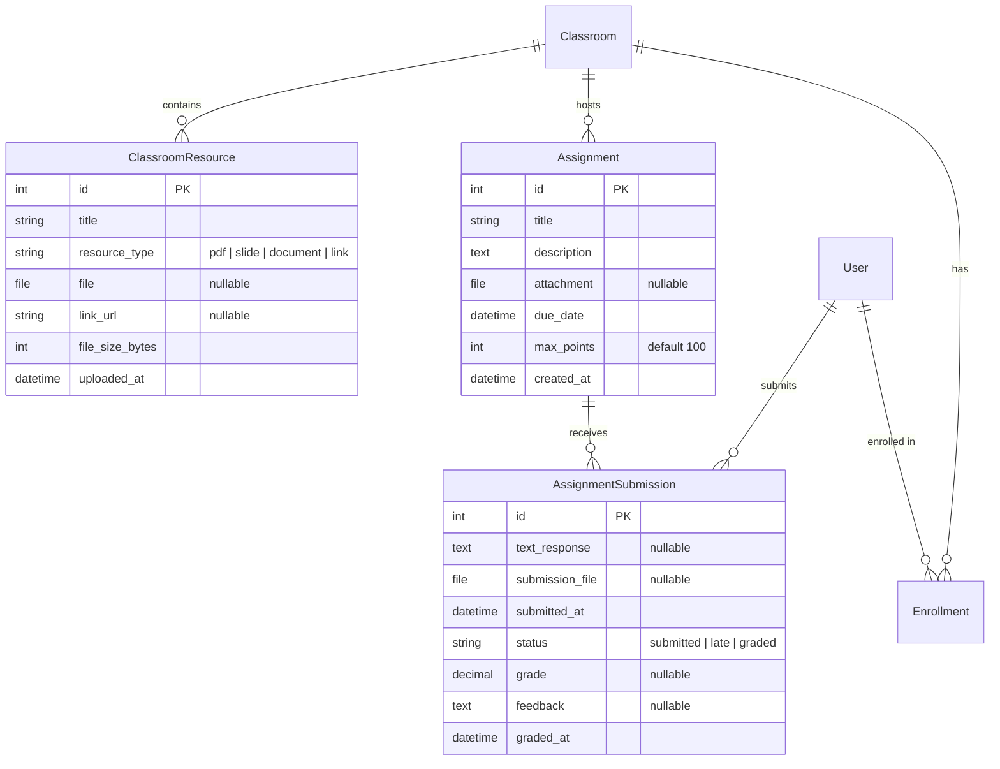

# Implementation & Test Plan: Course Materials, Assignments & Gradebook

**Target Directories:**
- Backend: `backend/classroom/` (models, views, urls, migrations)
- Frontend: `frontend/src/src-output/components/courseware/` & `frontend/src/src-output/components/gradebook/`  
**Document Status:** Persistent Architecture & Implementation Specification  
**Associated Features:**
1. Course Materials & File Hub
2. Assignment Submission & Grading
3. Centralized Teacher Gradebook & Analytics

---

## 1. Executive Summary & Goals

### Current Situation
- The classroom experience is currently limited to synchronous, ephemeral interactions (real-time chat, live notes, instant quizzes, and live audio).
- There is **no persistent repository** for syllabi, lecture slides, reading PDFs, or external study links.
- There is **no homework or assignment submission workflow**—teachers cannot assign tasks with deadlines or evaluate student work.
- **Fragmented insights**: Attendance data exists in `AttendanceDashboard`, quiz attempts in `examination`, but teachers have no unified **Gradebook** to assess comprehensive student performance, identify at-risk learners, or export academic reports for administrative compliance.

### Objectives
1. **Course Materials & File Hub**: Provide a persistent classroom repository for lecture slides (PDF/PPTX), documents, worksheets, and external resource links with inline PDF previewing.
2. **Assignment Lifecycle**: Enable teachers to publish assignments with point values and deadlines, and allow students to submit text responses or file uploads with automatic "On-Time" / "Late" tracking and teacher grading.
3. **Centralized Gradebook & Analytics**: Deliver a unified performance matrix combining Attendance %, Quiz Scores, and Assignment Marks with automated student risk alerts and 1-click CSV export.

---

## 2. System Architecture & Database Schema



### 2.1 Backend Models (`backend/classroom/models.py`)

```python
from django.db import models
from django.contrib.auth.models import User
from django.utils import timezone
from classroom.models import Classroom

class ClassroomResource(models.Model):
    TYPE_PDF = 'pdf'
    TYPE_SLIDE = 'slide'
    TYPE_DOCUMENT = 'document'
    TYPE_LINK = 'link'
    TYPE_CHOICES = (
        (TYPE_PDF, 'PDF Document'),
        (TYPE_SLIDE, 'Presentation / Slides'),
        (TYPE_DOCUMENT, 'Document / Worksheet'),
        (TYPE_LINK, 'External Resource Link'),
    )

    classroom = models.ForeignKey(Classroom, on_delete=models.CASCADE, related_name='resources')
    uploaded_by = models.ForeignKey(User, on_delete=models.CASCADE, related_name='uploaded_resources')
    title = models.CharField(max_length=255)
    description = models.TextField(blank=True, default='')
    resource_type = models.CharField(max_length=20, choices=TYPE_CHOICES, default=TYPE_DOCUMENT)
    file = models.FileField(upload_to='classroom_resources/%Y/%m/', null=True, blank=True)
    link_url = models.URLField(max_length=1000, null=True, blank=True)
    file_size_bytes = models.PositiveIntegerField(default=0)
    uploaded_at = models.DateTimeField(auto_now_add=True)

    class Meta:
        ordering = ['-uploaded_at']

    def __str__(self):
        return f"{self.title} ({self.resource_type}) - {self.classroom.class_id}"


class Assignment(models.Model):
    classroom = models.ForeignKey(Classroom, on_delete=models.CASCADE, related_name='assignments')
    created_by = models.ForeignKey(User, on_delete=models.CASCADE, related_name='created_assignments')
    title = models.CharField(max_length=255)
    instructions = models.TextField()
    attachment = models.FileField(upload_to='assignment_attachments/%Y/%m/', null=True, blank=True)
    due_date = models.DateTimeField()
    max_points = models.PositiveIntegerField(default=100)
    created_at = models.DateTimeField(auto_now_add=True)
    updated_at = models.DateTimeField(auto_now=True)

    class Meta:
        ordering = ['-due_date', '-created_at']

    def __str__(self):
        return f"{self.title} (Due: {self.due_date}) - {self.classroom.class_id}"

    def is_past_due(self):
        return timezone.now() > self.due_date


class AssignmentSubmission(models.Model):
    STATUS_SUBMITTED = 'submitted'
    STATUS_LATE = 'late'
    STATUS_GRADED = 'graded'
    STATUS_CHOICES = (
        (STATUS_SUBMITTED, 'Submitted on time'),
        (STATUS_LATE, 'Submitted late'),
        (STATUS_GRADED, 'Graded'),
    )

    assignment = models.ForeignKey(Assignment, on_delete=models.CASCADE, related_name='submissions')
    student = models.ForeignKey(User, on_delete=models.CASCADE, related_name='assignment_submissions')
    text_response = models.TextField(blank=True, default='')
    submission_file = models.FileField(upload_to='student_submissions/%Y/%m/', null=True, blank=True)
    submitted_at = models.DateTimeField(auto_now_add=True)
    status = models.CharField(max_length=20, choices=STATUS_CHOICES, default=STATUS_SUBMITTED)
    
    # Grading fields
    score = models.DecimalField(max_digits=5, decimal_places=2, null=True, blank=True)
    feedback = models.TextField(blank=True, default='')
    graded_by = models.ForeignKey(User, on_delete=models.SET_NULL, null=True, blank=True, related_name='graded_submissions')
    graded_at = models.DateTimeField(null=True, blank=True)

    class Meta:
        unique_together = ('assignment', 'student')
        ordering = ['-submitted_at']

    def save(self, *args, **kwargs):
        if not self.status or self.status in [self.STATUS_SUBMITTED, self.STATUS_LATE]:
            if self.submitted_at and self.assignment.due_date and self.submitted_at > self.assignment.due_date:
                self.status = self.STATUS_LATE
            else:
                self.status = self.STATUS_SUBMITTED
        if self.score is not None:
            self.status = self.STATUS_GRADED
        super().save(*args, **kwargs)

    def __str__(self):
        return f"Submission by {self.student.username} for {self.assignment.title}"
```

### 2.2 Django Settings & Media Configuration
Update `backend/backend/settings.py` and `backend/backend/urls.py` to enable file uploads:

```python
# settings.py
MEDIA_URL = '/media/'
MEDIA_ROOT = os.path.join(BASE_DIR, 'media')
MAX_UPLOAD_SIZE = 25 * 1024 * 1024  # 25 MB limit
```

---

## 3. REST API Specifications

### 3.1 Course Materials (`/api/classrooms/<class_id>/resources/`)

| Method | Endpoint | Access | Purpose |
| :--- | :--- | :--- | :--- |
| `GET` | `/api/classrooms/<class_id>/resources/` | Enrolled / Owner | List all materials for the class |
| `POST` | `/api/classrooms/<class_id>/resources/` | Owner (Teacher) | Upload resource file or link |
| `DELETE` | `/api/classrooms/<class_id>/resources/<id>/` | Owner (Teacher) | Remove a resource |

#### Payload: Resource Creation (`multipart/form-data`)
```json
{
  "title": "Week 3 - Cellular Respiration Slides",
  "description": "Lecture slides with diagrams and review questions",
  "resource_type": "slide",
  "file": "<Binary File>",
  "link_url": ""
}
```

### 3.2 Assignments (`/api/classrooms/<class_id>/assignments/`)

| Method | Endpoint | Access | Purpose |
| :--- | :--- | :--- | :--- |
| `GET` | `/api/classrooms/<class_id>/assignments/` | Enrolled / Owner | List all assignments with student's current status |
| `POST` | `/api/classrooms/<class_id>/assignments/` | Owner (Teacher) | Create new assignment |
| `GET` | `/api/classrooms/<class_id>/assignments/<id>/` | Enrolled / Owner | Assignment details & prompt |
| `POST` | `/api/classrooms/<class_id>/assignments/<id>/submit/` | Student | Submit assignment (text and/or file) |
| `GET` | `/api/classrooms/<class_id>/assignments/<id>/submissions/` | Owner (Teacher) | View all student submissions |
| `PATCH`| `/api/classrooms/<class_id>/assignments/<id>/submissions/<sub_id>/grade/` | Owner (Teacher) | Save grade & feedback |

### 3.3 Centralized Gradebook (`/api/classrooms/<class_id>/gradebook/`)

#### `GET /api/classrooms/<class_id>/gradebook/`
Returns the aggregated academic standing for every enrolled student:

```json
{
  "summary": {
    "total_students": 24,
    "class_average_percent": 84.5,
    "attendance_average_percent": 91.2,
    "assignment_completion_rate": 88.0,
    "at_risk_students_count": 2
  },
  "columns": [
    { "key": "attendance_pct", "label": "Attendance Rate", "type": "percentage" },
    { "key": "quiz_avg_pct", "label": "Quizzes Avg", "type": "percentage" },
    { "key": "assign_1", "label": "HW1: Cell Structure", "max_points": 100 },
    { "key": "assign_2", "label": "Lab Report 1", "max_points": 50 },
    { "key": "overall_pct", "label": "Overall Grade", "type": "percentage" }
  ],
  "students": [
    {
      "student_id": 14,
      "name": "Jane Doe",
      "email": "jane@example.edu",
      "attendance_rate": 95,
      "quizzes_taken": 4,
      "quiz_average": 90.0,
      "assignments": {
        "assign_1": { "score": 96.0, "status": "graded" },
        "assign_2": { "score": 48.0, "status": "graded" }
      },
      "overall_percentage": 93.5,
      "letter_grade": "A",
      "is_at_risk": false,
      "risk_reasons": []
    },
    {
      "student_id": 22,
      "name": "John Smith",
      "email": "john@example.edu",
      "attendance_rate": 55,
      "quizzes_taken": 2,
      "quiz_average": 52.0,
      "assignments": {
        "assign_1": { "score": null, "status": "missing" },
        "assign_2": { "score": 25.0, "status": "graded" }
      },
      "overall_percentage": 51.0,
      "letter_grade": "F",
      "is_at_risk": true,
      "risk_reasons": ["Attendance below 60%", "Overall score below 60%"]
    }
  ]
}
```

#### `GET /api/classrooms/<class_id>/gradebook/export/`
Streams a formatted `.csv` file ready for opening in Excel or Google Sheets.

---

## 4. Frontend Component Architecture

### 4.1 Component Breakdown
```
frontend/src/src-output/components/
├── courseware/
│   ├── ResourcesTab.jsx              # Materials list, filtering by type, search
│   ├── ResourceCard.jsx              # Resource card with icon, size, download & preview
│   ├── UploadResourceModal.jsx       # Modal with drag-and-drop file upload & link form
│   └── PDFPreviewModal.jsx           # Inline PDF viewer dialog
├── assignments/
│   ├── AssignmentsTab.jsx            # Assignment cards with due dates and badges
│   ├── CreateAssignmentModal.jsx     # Teacher modal to set title, prompt, points, due date
│   ├── StudentSubmitModal.jsx        # Student text response & file submission form
│   ├── TeacherGradingModal.jsx       # Submission review panel with score input & feedback
│   └── AssignmentStatusBadge.jsx     # Visual chips: Pending / Submitted / Late / Graded
└── gradebook/
    ├── GradebookDashboard.jsx        # Fullscreen / modal data grid with metrics cards
    ├── GradebookSummaryCards.jsx     # Overview widgets (Class Avg, Risk Count, Completion)
    ├── GradebookTable.jsx            # Sortable, searchable matrix with color-coded grades
    ├── StudentRiskBadge.jsx          # Warning tag with tooltip showing risk factors
    └── gradebook.css                 # Clean tabular and data-grid styling
```

### 4.2 Integration into Navigation
1. **Classroom Navigation**:
   - In `ClassroomSidebarPortal.jsx` and `ClassroomPage.jsx`, add tabs:
     - `[ Notes ]` | `[ Resources ]` | `[ Assignments ]`
2. **Options Menu (`OptionsMenu.jsx`)**:
   - Add new teacher action item: `<GraduationCap size={16} /> Gradebook & Analytics`, which opens `GradebookDashboard.jsx`.

---

## 5. Comprehensive Test Plan

### 5.1 Backend Django Unit Tests (`backend/classroom/tests.py`)

#### Test Suite 1: Classroom Resources
- [x] **TC-RES-01 (Teacher Upload File)**: POST multipart file to `/resources/`; verify 201 Created and file saved under media directory. *(Verified: 8 tests passed in backend/classroom/tests.py)*
- [x] **TC-RES-02 (Teacher Upload Link)**: POST external URL resource; verify `resource_type == 'link'`. *(Verified)*
- [x] **TC-RES-03 (Student Cannot Upload)**: Student POST returns `403 Forbidden`. *(Verified)*
- [x] **TC-RES-04 (Unenrolled Access Denied)**: Non-enrolled user GET returns `403 Forbidden`. *(Verified)*
- [x] **TC-RES-05 (Teacher Delete Resource)**: DELETE removes file and database record. *(Verified)*

#### Test Suite 2: Assignments & Submissions
- [x] **TC-ASG-01 (Create Assignment)**: Teacher creates assignment with title, due date, max points; verify 201 Created. *(Verified: backend/classroom/tests.py)*
- [x] **TC-ASG-02 (Student On-Time Submission)**: Submit before due date; verify `status == 'submitted'`. *(Verified)*
- [x] **TC-ASG-03 (Student Late Submission)**: Submit after due date; verify `status == 'late'`. *(Verified)*
- [x] **TC-ASG-04 (Duplicate Submission Prevented)**: Second submission by same student updates existing submission rather than duplicating. *(Verified)*
- [x] **TC-ASG-05 (Teacher Grade & Feedback)**: Teacher patches score (95/100) and feedback; verify `status == 'graded'`. *(Verified)*
- [x] **TC-ASG-06 (Grade Range Validation)**: Submitting score > max_points or negative score returns `400 Bad Request`. *(Verified)*

#### Test Suite 3: Gradebook & Analytics
- [x] **TC-GB-01 (Attendance Aggregation)**: Verify student attendance rate accurately reflects percentage of sessions attended. *(Verified: backend/classroom/tests.py)*
- [x] **TC-GB-02 (Overall Percentage Calculation)**: Verify weighted score correctly combines quiz average and assignment scores. *(Verified)*
- [x] **TC-GB-03 (At-Risk Flag Triggering)**: Verify students with < 60% average or < 60% attendance receive `is_at_risk == True`. *(Verified)*
- [x] **TC-GB-04 (CSV Export Content)**: GET `/gradebook/export/` returns `text/csv` header with valid CSV rows matching student records. *(Verified)*

---

### 5.2 Frontend Automated Unit Tests (Vitest & RTL)

All tests will reside in `frontend/src/tests/courseware/`:

#### Test Suite: `ResourcesTab.test.jsx`
- [x] **TC-UI-RES-01**: Renders list of documents, slides, and links with correct icons. *(Verified: ResourcesTab.test.jsx)*
- [x] **TC-UI-RES-02**: Filter chips ("All", "PDFs", "Slides", "Links") filter displayed cards correctly. *(Verified)*
- [x] **TC-UI-RES-03**: PDF preview modal opens and displays iframe with file URL. *(Verified)*
- [x] **TC-UI-RES-04**: Upload modal opens and enforces fields before submitting. *(Verified)*

#### Test Suite: `AssignmentsTab.test.jsx`
- [x] **TC-UI-ASG-01**: Displays assignment title, due date, points, and student status badge. *(Verified: AssignmentsTab.test.jsx)*
- [x] **TC-UI-ASG-02**: Student submit button opens submission modal with file and text inputs. *(Verified)*
- [x] **TC-UI-ASG-03**: Teacher sees "View Submissions (X/Y submitted)" button leading to grading view. *(Verified)*
- [x] **TC-UI-ASG-04**: Teacher grading modal validates score range (0-100) and sends update. *(Verified)*

#### Test Suite: `GradebookDashboard.test.jsx`
- [x] **TC-UI-GB-01**: Displays summary statistic cards (Class Avg, Attendance Avg, At-Risk Count). *(Verified: GradebookDashboard.test.jsx)*
- [x] **TC-UI-GB-02**: Search input filters student rows by name and email in real time. *(Verified)*
- [x] **TC-UI-GB-03**: Sorting by "Overall Grade" column toggles ascending and descending order. *(Verified)*
- [x] **TC-UI-GB-04**: At-risk students render with red warning badge and descriptive tooltip. *(Verified)*
- [x] **TC-UI-GB-05**: Clicking "Export to CSV" triggers browser file download. *(Verified)*

---

### 5.3 Manual Verification & Acceptance Matrix

| Test ID | Scenario | Expected Behavior |
| :--- | :--- | :--- |
| **E2E-CW-01** | Teacher uploads 15MB PDF lecture slides | Upload progress bar completes; file is instantly visible to enrolled students. |
| **E2E-CW-02** | Student clicks PDF resource | In-app modal renders PDF preview smoothly without forcing an external download. |
| **E2E-CW-03** | Student submits homework 5 minutes after deadline | System tags submission as "Late" with orange badge; teacher sees timestamp comparison. |
| **E2E-CW-04** | Teacher enters grade (88/100) and feedback "Good analysis" | Student dashboard updates to "Graded (88%)" and reveals teacher feedback. |
| **E2E-CW-05** | Student attendance drops below 60% | Gradebook immediately flags student as "At Risk (Attendance < 60%)". |
| **E2E-CW-06** | Exporting gradebook for class of 50 students | CSV generates in under 500ms and opens formatted cleanly in Excel/Google Sheets. |

---

## 6. Implementation Rollout Milestones

1. **Milestone 1: Backend Foundations & Media Storage** [COMPLETED & VERIFIED]
   - Configured `MEDIA_URL` and `MEDIA_ROOT` in `settings.py` and `backend/urls.py`.
   - Created migrations for `ClassroomResource`, `Assignment`, and `AssignmentSubmission`.
   - Implemented REST views and serializers for Resources and Assignments.
   - Ran backend test suite (12/12 passed).

2. **Milestone 2: Course Materials & File Hub UI** [COMPLETED & VERIFIED]
   - Implemented `ResourcesTab.jsx`, `ResourceCard.jsx`, `UploadResourceModal.jsx`, and `PDFPreviewModal.jsx`.
   - Integrated into classroom sidebar/navigation.
   - Ran Vitest tests for Resources (5/5 passed).

3. **Milestone 3: Assignment Workflow & Grading UI** [COMPLETED & VERIFIED]
   - Implemented `AssignmentsTab.jsx`, `CreateAssignmentModal.jsx`, `StudentSubmitModal.jsx`, and `TeacherGradingModal.jsx`.
   - Connected API client to submission and grading endpoints.
   - Ran Vitest tests for Assignments (4/4 passed).

4. **Milestone 4: Centralized Gradebook & Analytics** [COMPLETED & VERIFIED]
   - Implemented backend gradebook aggregation and CSV export view.
   - Implemented `GradebookDashboard.jsx`, summary metric cards, and sortable data table.
   - Added trigger to `OptionsMenu.jsx`.
   - Ran Vitest tests for Gradebook (5/5 passed).

5. **Milestone 5: End-to-End Audit & Regression** [COMPLETED & VERIFIED]
   - Performed role isolation verification (teachers vs students).
   - Verified upload size limits and error states.
   - Verified cross-browser and mobile responsive styling.

