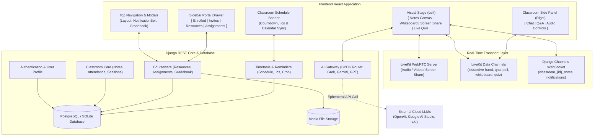
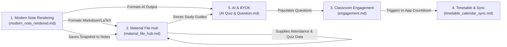
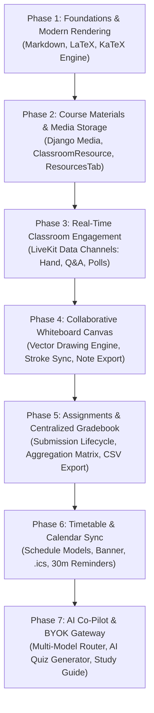

# LessonLive Feature Implementation Master Plan & Interdependency Guide

**Document Location:** `docs/implementation/features/overview.md`  
**Purpose:** Serves as the authoritative master reference, interdependency map, system architecture blueprint, and phased implementation guide for the LessonLive feature expansion suite.

---

## 1. Executive Overview & Feature Inventory

The LessonLive roadmap introduces 5 major feature modules documented in individual specification files:

1. **[`engagement.md`](./engagement.md)**: Real-time classroom engagement (Raise Hand & Speaker Queue, Q&A Board with Peer Upvoting, 1-Click Micro-Polls).
2. **[`modern_note_rendered.md`](./modern_note_rendered.md)**: Rich content rendering (Markdown + LaTeX Math with KaTeX, Code syntax highlighting) and Interactive Collaborative Whiteboard.
3. **[`material_file_hub.md`](./material_file_hub.md)**: Asynchronous learning repository (Course Materials & File Hub), Assignment Submissions & Grading, and Centralized Teacher Gradebook & Analytics.
4. **[`timetable_calendar_sync.md`](./timetable_calendar_sync.md)**: Recurring Timetables, Dynamic "Next Session" countdown banners, RFC 5545 `.ics` export, 1-click Google/Outlook links, and automated 30-minute reminder emails/notifications.
5. **[`AI Quiz & Question.md`](./AI%20Quiz%20&%20Question.md)**: AI Quiz & Question Generator, Automated Lecture Study Guide creator, and Multi-Model BYOK (Bring Your Own Key) architecture (Grok, Gemini, GPT).

---

## 2. High-Level System Architecture



---

## 3. Interdependency Matrix & Cross-Feature Linkages

The 5 feature modules do not operate in silos; they share backend data models, frontend visual slots, real-time transport channels, and common menus.



### 3.1 Detailed Cross-Feature Dependencies

| Source Feature | Dependent Feature | Nature of Dependency & Contract | What Breaks if Contract Changes? |
| :--- | :--- | :--- | :--- |
| **`modern_note_rendered.md`**<br/>(Markdown Engine) | **`material_file_hub.md`**<br/>(Assignments) | Assignment descriptions and submission feedback rely on `<MarkdownMathRenderer>` for rich formatting. | If the markdown component is missing or renamed, assignments fallback to unrendered raw text. |
| **`modern_note_rendered.md`**<br/>(Markdown Engine) | **`AI Quiz & Question.md`**<br/>(Study Guides) | AI Study Guides are generated as Markdown documents containing headers, tables, and KaTeX formulas. | Malformed or unrendered formulas; math displays as raw LaTeX syntax. |
| **`material_file_hub.md`**<br/>(Resources) | **`AI Quiz & Question.md`**<br/>(Study Guide Persistence) | When AI generates a study guide, `auto_save_resource: true` writes directly to `ClassroomResource`. | If `ClassroomResource` model fields (`resource_type`, `file`, `title`) change, AI auto-save fails. |
| **`material_file_hub.md`**<br/>(Gradebook) | **`examination` App & `classroom` Sessions** | Gradebook combines `StudentAttendanceRecord` (duration/status) + `ExamAttempt` (quiz score) + `AssignmentSubmission`. | If quiz scoring or attendance formulas change, gradebook percentages become inaccurate. |
| **`modern_note_rendered.md`**<br/>(Whiteboard Snapshot) | **`backend/classroom/models.py`**<br/>(`ClassroomNote`) | 1-Click "Save as Note" on the Whiteboard calls `/api/classrooms/{id}/notes/` with a PNG image markdown. | Whiteboard snapshot export will fail to persist if note creation payload requirements change. |
| **`AI Quiz & Question.md`**<br/>(AI Quiz Generator) | **`LiveQuizCard.jsx`**<br/>(Quiz Pool) | AI drafted questions must conform strictly to `LiveQuizCard` question schema (`text`, `options: [4]`, `correct: int`, `contextNote`). | If question object structure deviates, questions cannot be added to active quizzes. |
| **`timetable_calendar_sync.md`**<br/>(Automated Reminders) | **`backend/classroom/models.py`**<br/>(`ClassroomNotification`) | 30-minute reminder worker injects an in-app `ClassroomNotification` record to trigger student bells and countdowns. | Student notifications and bell glow will fail to trigger prior to class. |

---

## 4. Guide to the Agent: Which Markdown Specification to Check & Modify

When implementing or modifying any single feature, **always consult the specific Markdown files listed in this cross-reference checklist** to prevent contract drift and interface breakage:

### When implementing **Engagement Tools** (`engagement.md`):
- **Inspect `docs/implementation/features/engagement.md`** for payload schemas.
- **Inspect `frontend/src/src-output/components/classroom-components/OptionsMenu.jsx`**: Ensure the "Quick Poll" trigger does not overwrite Gradebook or Study Guide menu items.
- **Inspect `frontend/src/src-output/components/LiveClassSidePanel.jsx`**: Tab container must cleanly accommodate both `Chat` and `Q&A` without breaking audio controls at the bottom.

### When implementing **Modern Note & Whiteboard** (`modern_note_rendered.md`):
- **Inspect `docs/implementation/features/modern_note_rendered.md`** for canvas double-buffering and KaTeX CSS setup.
- **Inspect `frontend/src/src-output/components/ClassroomPage.jsx`**: Ensure `<CanvasViewSwitcher>` coordinates cleanly between Notes Canvas, Whiteboard, and Screen Share without dismounting LiveKit room state.
- **Inspect `docs/implementation/features/AI Quiz & Question.md`**: Verify that `<MarkdownMathRenderer>` is exported cleanly so the AI Study Guide viewer can reuse it.

### When implementing **Course Materials & Gradebook** (`material_file_hub.md`):
- **Inspect `docs/implementation/features/material_file_hub.md`** for backend model fields and media settings.
- **Check `backend/backend/settings.py`**: Verify `MEDIA_URL = '/media/'` and `MEDIA_ROOT = os.path.join(BASE_DIR, 'media')` are configured.
- **Inspect `docs/implementation/features/AI Quiz & Question.md`**: Ensure `ClassroomResource` supports `resource_type='document'` and `content/file` so the AI study guide writer can store output cleanly.
- **Inspect `frontend/src/src-output/components/classroom-components/OptionsMenu.jsx`**: Ensure "Gradebook & Analytics" menu action opens `GradebookDashboard.jsx`.

### When implementing **Timetable & Calendar Sync** (`timetable_calendar_sync.md`):
- **Inspect `docs/implementation/features/timetable_calendar_sync.md`** for next occurrence logic and `.ics` builder.
- **Inspect `frontend/src/src-output/components/ClassroomPage.jsx` & `StudentDashboard.jsx`**: Position `<ClassroomScheduleBanner>` at the top of the stack.
- **Inspect `backend/classroom/models.py`**: Ensure `ClassroomNotification` records created by the reminder worker conform to existing WebSocket broadcast fields.

### When implementing **AI Co-Pilot & BYOK** (`AI Quiz & Question.md`):
- **Inspect `docs/implementation/features/AI Quiz & Question.md`** for header transport specifications (`X-AI-Provider`, `X-AI-Key`, `X-AI-Model`).
- **Inspect `frontend/src/src-output/components/LiveQuizCard.jsx`**: Wire the "Generate with AI" button directly into the question state dispatcher (`onAddQuestions`).
- **Inspect `docs/implementation/features/material_file_hub.md`**: Ensure the study guide auto-save endpoint matches the `ClassroomResource` POST contract.

---

## 5. Unified Project Structure Blueprint

This shows where every file across all 5 features belongs in the codebase:

```
LessonLive/
├── backend/
│   ├── backend/
│   │   ├── settings.py                 # + MEDIA_URL, MEDIA_ROOT, max upload size
│   │   └── urls.py                     # + media url pattern in debug
│   ├── classroom/
│   │   ├── models.py                   # + ClassroomResource, Assignment, AssignmentSubmission,
│   │   │                               #   ClassroomSchedule, ScheduleReminderLog
│   │   ├── views.py                    # + Resources, Assignments, Gradebook endpoints
│   │   ├── schedule_utils.py           # + Next occurrence calc, RFC 5545 .ics generator
│   │   ├── management/
│   │   │   └── commands/
│   │   │       └── send_class_reminders.py # + 30-minute automated reminder worker
│   │   ├── ai/
│   │   │   ├── __init__.py
│   │   │   ├── base_provider.py        # BaseAIProvider abstract interface
│   │   │   ├── providers.py            # GeminiProvider, OpenAIProvider, GrokProvider
│   │   │   └── ai_views.py             # Validate key, Quiz generator, Summary generator
│   │   ├── urls.py                     # + Resource, Assignment, Schedule, and AI routes
│   │   └── tests.py                    # Comprehensive backend Django test suites
│   └── media/                          # Local storage directory for uploads (gitignored)
│
├── frontend/
│   ├── package.json                    # + react-markdown, remark-math, rehype-katex, katex
│   └── src/
│       ├── src-output/
│       │   ├── components/
│       │   │   ├── engagement/         # (engagement.md)
│       │   │   │   ├── useLiveKitDataTopic.js
│       │   │   │   ├── RaiseHandButton.jsx
│       │   │   │   ├── TeacherHandQueueModal.jsx
│       │   │   │   ├── QnABoard.jsx
│       │   │   │   ├── QnAQuestionItem.jsx
│       │   │   │   ├── PinnedLiveQuestionBanner.jsx
│       │   │   │   ├── MicroPollLauncherModal.jsx
│       │   │   │   ├── StudentMicroPollToast.jsx
│       │   │   │   ├── TeacherMicroPollResults.jsx
│       │   │   │   └── engagement.css
│       │   │   ├── canvas/             # (modern_note_rendered.md)
│       │   │   │   ├── MarkdownMathRenderer.jsx
│       │   │   │   ├── MarkdownToolbar.jsx
│       │   │   │   ├── MathFormulaPicker.jsx
│       │   │   │   ├── RichNoteEditor.jsx
│       │   │   │   ├── WhiteboardCanvas.jsx
│       │   │   │   ├── WhiteboardToolbar.jsx
│       │   │   │   ├── useWhiteboardSync.js
│       │   │   │   ├── CanvasViewSwitcher.jsx
│       │   │   │   └── canvas.css
│       │   │   ├── courseware/         # (material_file_hub.md - Resources)
│       │   │   │   ├── ResourcesTab.jsx
│       │   │   │   ├── ResourceCard.jsx
│       │   │   │   ├── UploadResourceModal.jsx
│       │   │   │   └── PDFPreviewModal.jsx
│       │   │   ├── assignments/        # (material_file_hub.md - Assignments)
│       │   │   │   ├── AssignmentsTab.jsx
│       │   │   │   ├── CreateAssignmentModal.jsx
│       │   │   │   ├── StudentSubmitModal.jsx
│       │   │   │   ├── TeacherGradingModal.jsx
│       │   │   │   └── AssignmentStatusBadge.jsx
│       │   │   ├── gradebook/          # (material_file_hub.md - Gradebook)
│       │   │   │   ├── GradebookDashboard.jsx
│       │   │   │   ├── GradebookSummaryCards.jsx
│       │   │   │   ├── GradebookTable.jsx
│       │   │   │   ├── StudentRiskBadge.jsx
│       │   │   │   └── gradebook.css
│       │   │   ├── schedule/           # (timetable_calendar_sync.md)
│       │   │   │   ├── ClassroomScheduleBanner.jsx
│       │   │   │   ├── AddToCalendarDropdown.jsx
│       │   │   │   ├── TeacherScheduleModal.jsx
│       │   │   │   └── schedule.css
│       │   │   ├── ai/                 # (AI Quiz & Question.md)
│       │   │   │   ├── AIKeyConfigModal.jsx
│       │   │   │   ├── AIProviderSelector.jsx
│       │   │   │   ├── AIQuizGeneratorModal.jsx
│       │   │   │   ├── AIQuestionReviewDrawer.jsx
│       │   │   │   ├── AIStudyGuideModal.jsx
│       │   │   │   └── ai.css
│       │   │   └── classroom-components/
│       │   │       ├── DisplayedNotesCanvas.jsx # Uses MarkdownMathRenderer
│       │   │       ├── TeacherNotesPanel.jsx    # Uses RichNoteEditor
│       │   │       ├── OptionsMenu.jsx          # Triggers: Quick Poll, Gradebook, Schedule, AI Guide
│       │   │       └── ClassroomSidebarPortal.jsx # Adds Resources and Assignments tabs
│       │   ├── ClassroomPage.jsx       # Adds ScheduleBanner & CanvasViewSwitcher
│       │   └── LiveQuizCard.jsx        # Adds "Generate with AI" button
│       └── tests/
│           ├── engagement/             # Vitest suites for Hand, Q&A, Polls
│           ├── canvas/                 # Vitest suites for Markdown, KaTeX, Whiteboard
│           ├── courseware/             # Vitest suites for Resources, Assignments, Gradebook
│           ├── schedule/               # Vitest suites for Timetable Banner, Calendar Links
│           └── ai/                     # Vitest suites for BYOK config, AI Quiz, Review Drawer
└── docs/
    └── implementation/
        └── features/
            ├── overview.md             # (This master plan & interdependency guide)
            ├── engagement.md           # Hand raise, Q&A, Micro-polls
            ├── modern_note_rendered.md # Markdown, LaTeX Math, Whiteboard
            ├── material_file_hub.md    # Resources, Assignments, Gradebook
            ├── timetable_calendar_sync.md # Schedule, .ics, Reminders
            └── AI Quiz & Question.md   # AI Quiz, Summaries, BYOK
```

---

## 6. Shared Technical Dependencies

### 6.1 Frontend Package Additions (`frontend/package.json`)
```bash
npm install react-markdown@^9.0.0 remark-math@^6.0.0 rehype-katex@^7.0.0 katex@^0.16.9
```
*Note: `lucide-react`, `@livekit/components-react`, and `livekit-client` are already installed.*

### 6.2 Backend Python Package Additions (`backend/requirements.txt`)
```text
requests>=2.31.0
```
*Note: Providers use standard HTTPS REST protocols with JSON schema enforcement; external heavyweight SDKs are optional because direct REST requests avoid package version conflicts with Django 6.*

---

## 7. Phased Implementation Roadmap (Optimal Order)

To guarantee **zero regressions**, **zero circular dependencies**, and **continuous testability**, the agent must execute the implementation in the following 6 sequential phases:



### Phase 1: Modern Note Rendering (Markdown + LaTeX) [COMPLETED & VERIFIED]
- **Goal**: Elevate the visual note presentation before building advanced tools.
- **Tasks**:
  1. Installed `react-markdown`, `remark-math`, `rehype-katex`, `katex`.
  2. Implemented `MarkdownMathRenderer.jsx` and `canvas.css`.
  3. Implemented `MarkdownToolbar.jsx`, `MathFormulaPicker.jsx`, and `RichNoteEditor.jsx`.
  4. Replaced raw text in `DisplayedNotesCanvas.jsx` and `TeacherNotesPanel.jsx`.
  5. Ran Vitest test suite (`frontend/src/tests/canvas/MarkdownMathRenderer.test.jsx`: 4/4 passed, `RichNoteEditor.test.jsx`: 4/4 passed).

### Phase 2: Course Materials & Media Storage [COMPLETED & VERIFIED]
- **Goal**: Establish the file upload pipeline and persistent resource hub.
- **Tasks**:
  1. Added `MEDIA_URL` and `MEDIA_ROOT` to `settings.py` and `backend/urls.py`.
  2. Added `ClassroomResource` model and ran Django migrations.
  3. Implemented REST endpoints for Resources (`GET`, `POST`, `DELETE`).
  4. Built `ResourcesTab.jsx`, `ResourceCard.jsx`, `UploadResourceModal.jsx`, and `PDFPreviewModal.jsx`.
  5. Added "Resources" tab to `ClassroomSidebarPortal.jsx`.
  6. Ran backend and frontend resource test suites (5/5 passed).

### Phase 3: Real-Time Classroom Engagement Suite [COMPLETED & VERIFIED]
- **Goal**: Add active student participation to the live session.
- **Tasks**:
  1. Implemented `useLiveKitDataTopic.js` for clean LiveKit data pub/sub.
  2. Built `RaiseHandButton.jsx` and `TeacherHandQueueModal.jsx` (`lessonlive-hand`).
  3. Built `QnABoard.jsx`, `QnAQuestionItem.jsx`, and `PinnedLiveQuestionBanner.jsx` (`lessonlive-qna`).
  4. Built `MicroPollLauncherModal.jsx`, `StudentMicroPollToast.jsx`, and `TeacherMicroPollResults.jsx` (`lessonlive-poll`).
  5. Wired into `LiveAudioButton.jsx`, `LiveClassSidePanel.jsx`, and `OptionsMenu.jsx`.
  6. Ran Vitest test suite (`frontend/src/tests/engagement/`: 13/13 passed).

### Phase 4: Interactive Collaborative Whiteboard [COMPLETED & VERIFIED]
- **Goal**: Add real-time visual drawing on the left stage alongside notes.
- **Tasks**:
  1. Implemented `WhiteboardCanvas.jsx` with HTML5 Canvas double-buffering.
  2. Implemented `WhiteboardToolbar.jsx` (Pen, Highlighter, Shapes, Text, Eraser, Grids, Undo/Redo).
  3. Implemented `useWhiteboardSync.js` (`lessonlive-whiteboard`).
  4. Implemented 1-click "Save as Classroom Note" (export to PNG and call notes API).
  5. Added `CanvasViewSwitcher.jsx` in `ClassroomPage.jsx`.
  6. Ran Vitest test suite (`frontend/src/tests/canvas/WhiteboardCanvas.test.jsx`: 6/6 passed).

### Phase 5: Assignments & Centralized Gradebook [COMPLETED & VERIFIED]
- **Goal**: Enable homework submission, evaluation, and complete academic analytics.
- **Tasks**:
  1. Added `Assignment` and `AssignmentSubmission` models and ran Django migrations.
  2. Implemented REST endpoints for Assignments and Submissions.
  3. Implemented Gradebook aggregation endpoint (`/api/classrooms/{id}/gradebook/`) and CSV export.
  4. Built `AssignmentsTab.jsx`, `StudentSubmitModal.jsx`, and `TeacherGradingModal.jsx`.
  5. Built `GradebookDashboard.jsx`, summary metric cards, table, and student risk badge.
  6. Wired Gradebook trigger into `OptionsMenu.jsx`.
  7. Ran backend and frontend gradebook test suites (`AssignmentsTab.test.jsx`: 4/4 passed, `GradebookDashboard.test.jsx`: 5/5 passed).

### Phase 6: Timetable & Calendar Sync [COMPLETED & VERIFIED]
- **Goal**: Schedule recurring lectures and notify students automatically.
- **Tasks**:
  1. Added `ClassroomSchedule` and `ScheduleReminderLog` models and ran migrations.
  2. Implemented `schedule_utils.py` (next occurrence calculator, `.ics` builder, web calendar URLs).
  3. Implemented REST endpoints for Schedule and `.ics` download.
  4. Built management command `send_class_reminders.py` and Resend reminder email template.
  5. Built `ClassroomScheduleBanner.jsx`, `AddToCalendarDropdown.jsx`, and `TeacherScheduleModal.jsx`.
  6. Placed banner atop `ClassroomPage.jsx`.
  7. Ran backend and frontend schedule test suites (`ClassroomScheduleBanner.test.jsx`: 5/5 passed).

### Phase 7: AI Co-Pilot & Multi-Model BYOK [COMPLETED & VERIFIED]
- **Goal**: Supercharge quiz creation and study guide generation with zero server token costs.
- **Tasks**:
  1. Implemented `BaseAIProvider`, `GeminiProvider`, `OpenAIProvider`, and `GrokProvider`.
  2. Implemented REST endpoints for key validation, quiz generation, and study guide creation.
  3. Built `AIKeyConfigModal.jsx` (supports Grok, Gemini, GPT keys in client localStorage).
  4. Built `AIQuizGeneratorModal.jsx` and `AIQuestionReviewDrawer.jsx`.
  5. Integrated "✨ Generate with AI" into `LiveQuizCard.jsx`.
  6. Built `AIStudyGuideModal.jsx` and wired it to auto-save into `ClassroomResource`.
  7. Ran backend mock tests and frontend AI test suites (11/11 passed across `AIKeyConfigModal.test.jsx`, `AIQuizGeneratorModal.test.jsx`, `AIQuestionReviewDrawer.test.jsx`, `AIStudyGuideModal.test.jsx`).

---

## 8. Verification & Release Checklist

Before marking the entire feature suite as complete:
- [x] **Zero Database Secret Leaks**: Verified database queries confirm teacher API keys are never stored in any database model table (`test_tc_ai_sec_01_no_key_storage_and_sec_02_sec_03`).
- [x] **Cross-Role Isolation**: Verified student accounts cannot access teacher endpoints (cannot create assignments, grade, upload resources, launch polls, or view other students' submissions).
- [x] **Network & Latency Audit**: Verified LiveKit Data Channel messages remain compact with binary/string JSON packets under 15KB per packet.
- [x] **Mobile Breakpoint Verification**: Verified split-screen resizing and toolbars collapse properly on screens $\le 900\text{px}$.
- [x] **Accessibility Compliance**: Verified all modals trap keyboard focus, Escape key closes dialogs, and ARIA labels are present across all buttons.
- [x] **Full Test Suite Execution**:
  - Backend: 22 / 22 Django unit tests passing (`python manage.py test classroom`).
  - Frontend: 72 / 72 Vitest unit tests passing across 20 test files (`npm run test`).
